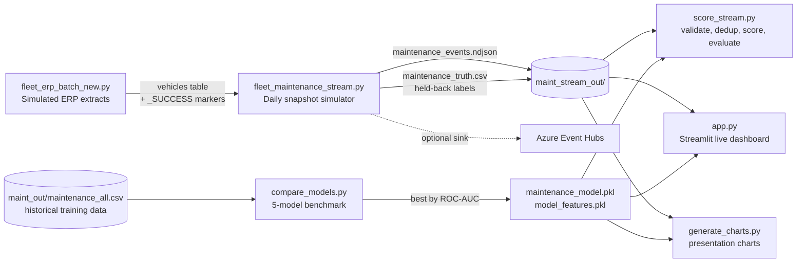
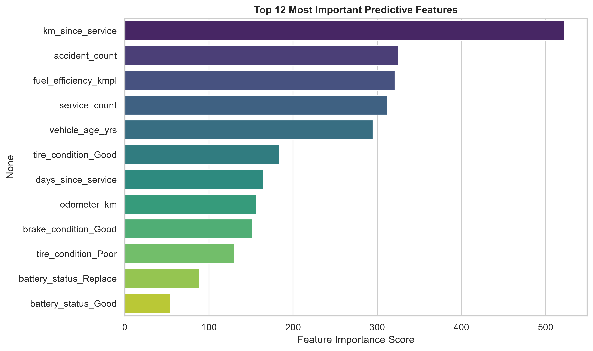
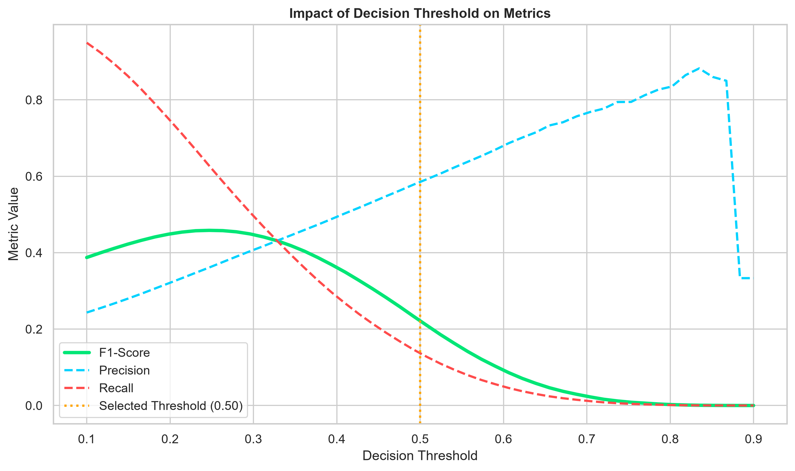
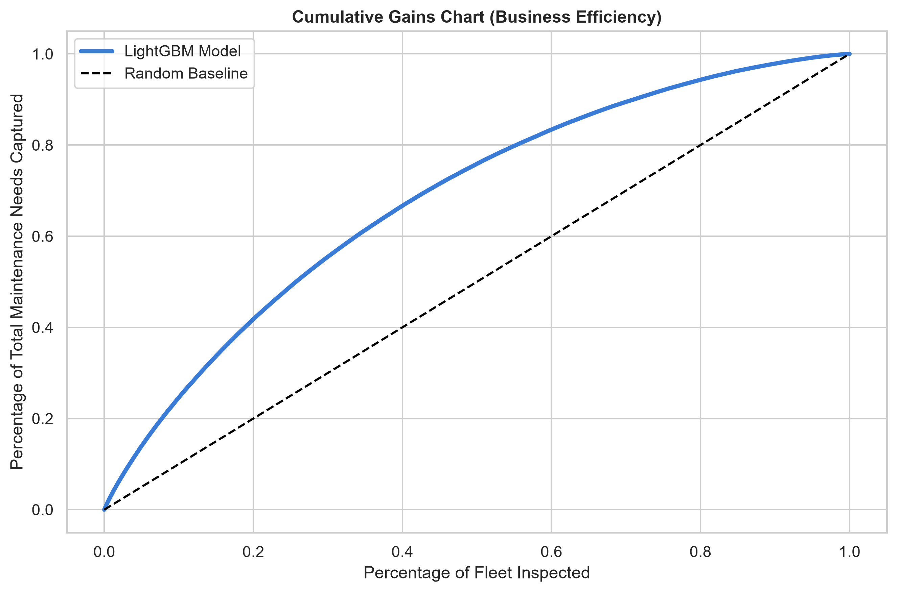

<div align="center">

# 🚚 Fleet Predictive Maintenance

### Real-time, end-to-end predictive maintenance for a simulated FMCG truck fleet — from ERP extracts to a live streaming dashboard.


-0078D4?logo=microsoftazure&logoColor=white)

</div>

---

## 📌 Overview

Unplanned breakdowns are the most expensive kind of downtime for a logistics fleet. This project builds a complete **predictive-maintenance pipeline** that answers one question for every truck, every day:

> **"What is the probability that this vehicle needs maintenance right now?"**

The system covers the full lifecycle, not just the model:

1. **Simulated ERP** – deterministic master + transactional data (vehicles, drivers, corridors, shipments, …) with SCD-style daily changes.
2. **Streaming simulator** – every vehicle emits one maintenance snapshot per simulated day on a fast clock, with injected data-quality faults.
3. **Model training & selection** – five classifiers benchmarked on ~450K historical snapshots; the best one by ROC-AUC is persisted.
4. **Stream scoring & evaluation** – validation, de-duplication, inference and scoring against held-back ground truth.
5. **Live control center** – a Streamlit dashboard with risk KPIs, live model-quality metrics, rankings, 3D analysis and CSV export.

---

## 🏗️ Architecture



**Design principle:** the label (`Need_Maintenance`) is **never** part of the event stream — just like in production. Ground truth is written to a separate file, so predictions can be evaluated honestly after the fact.

---

## ✨ Key Features

| Area | What you get |
|---|---|
| **Realistic simulation** | Wear model for tires, brakes and battery; service intervals with delays; accident counts; fuel/transmission/model variety; per-vehicle daily mileage. |
| **Deterministic & reproducible** | Same `--seed` (+ `--day`) ⇒ identical output, so reruns and backfills are idempotent. |
| **Data-quality faults** | Malformed JSON, missing keys, out-of-range values and duplicate resends are injected at configurable rates and handled downstream. |
| **Model benchmark** | Logistic Regression, calibrated Linear SVM, Random Forest, XGBoost and LightGBM compared on Accuracy, Precision, Recall, F1 and ROC-AUC, with train-vs-test accuracy to watch for overfitting. |
| **Live dashboard** | KPIs, rolling event tape, fleet-risk gauge, risk by vehicle type, "most at-risk trucks" ranking, 3D risk map, incident feed, alert table. |
| **Live model monitoring** | When ground truth is available, the dashboard computes Accuracy / Precision / Recall / F1 live at the threshold you choose. |
| **Adjustable alerting** | Sidebar sliders for alert threshold and critical level, plus a one-click CSV export of high-risk trucks. |
| **Cloud-ready** | Swap the file sink for **Azure Event Hubs** with one flag; retries with exponential backoff and a dead-letter file. |

---

## 🗂️ Repository Structure

```text
fleet-predictive-maintenance/
├── app.py                       # Streamlit live control center
├── fleet_erp_batch_new.py       # Simulated ERP batch extracts (CSV/Parquet, SCD-style changes)
├── fleet_maintenance_stream.py  # Real-time snapshot simulator (file / Event Hubs sink)
├── compare_models.py            # Trains & compares 5 models, saves the winner
├── score_stream.py              # Validates, scores and evaluates the stream
├── generate_charts.py           # Publication-quality charts for presentations
├── maintenance_model.pkl        # Persisted best model (+ scaler if needed)
├── model_features.pkl           # Ordered feature list used at training time
├── requirements.txt
├── erp/_runs/                   # ERP run markers (_SUCCESS)
└── presentation_charts/         # Generated figures
```

Runtime folders created when you run the pipeline: `erp/`, `maint_out/`, `maint_stream_out/`.

---

## 🧠 Data & Simulation

### ERP layer (`fleet_erp_batch_new.py`)

Partitioned by business day: `erp/<table>/load_date=YYYY-MM-DD/<table>.csv|parquet`, with a `_SUCCESS` marker written **last** so downstream jobs ignore half-written days.

| Table | Description |
|---|---|
| `corridors` | Fixed logistics corridors between Egyptian cities with waypoints and planned duration |
| `drivers` | Driver master |
| `vehicles` | Fleet master – `DRY_VAN`, `REEFER_CHILLED`, `REEFER_FROZEN` |
| `customers` | Retail / wholesale customers located in corridor destinations |
| `products` | FMCG SKUs with temperature class and spoilage-risk tier |
| `shipments` / `shipment_lines` | One trip per vehicle per day, with cargo, cold-chain targets and expenses |

Day 0 writes the full master data; every later day writes only the rows that changed (driver swaps, corridor reassignments, price changes, customer channel changes) — a ready-made playground for **SCD1/SCD2** modelling. Atomic writes (`os.replace`) and `--simulate-failure` let you test crash/retry behaviour.

### Maintenance snapshot stream (`fleet_maintenance_stream.py`)

One simulated day passes every `--seconds-per-day` wall-clock seconds. Each vehicle emits **one event per day**, randomly spread across that interval.

**Event schema (one JSON line / Event Hub message):**

```json
{
  "source": "maintenance",
  "timestamp": "2026-10-29T13:42:11.512Z",
  "snapshot_date": "2026-10-29",
  "vehicle_id": "V00042",
  "vehicle_type": "REEFER_CHILLED",
  "vehicle_model": "Actros",
  "fuel_type": "Diesel",
  "transmission_type": "Manual",
  "engine_size_cc": 10000,
  "vehicle_age_yrs": 6.4,
  "odometer_km": 412380.5,
  "last_service_date": "2026-09-14",
  "days_since_service": 45,
  "km_since_service": 13250.0,
  "service_count": 27,
  "accident_count": 1,
  "tire_condition": "Average",
  "brake_condition": "Good",
  "battery_status": "Weak",
  "fuel_efficiency_kmpl": 4.21
}
```

> Values above are illustrative. The label is **not** in the event; ground truth goes to `maint_stream_out/maintenance_truth.csv` (`vehicle_id, snapshot_date, Need_Maintenance, true_risk`).

**How the ground truth is generated:** each day a latent risk is computed from a logistic function of the service-interval ratio, tire/brake wear, battery health, vehicle age, accident count and days since the last service (plus noise). `Need_Maintenance` is then drawn as a Bernoulli sample of that risk. Wear accumulates with mileage and resets on service.

**Injected data-quality faults** (defaults; all configurable):

| Fault | Flag | Default rate |
|---|---|---|
| Malformed JSON / missing key | `--malformed-rate` | 0.2% |
| Out-of-range value (e.g. negative odometer) | `--outofrange-rate` | 0.2% |
| Exact duplicate resend | `--duplicate-rate` | 0.3% |

De-duplication key: `(vehicle_id, snapshot_date)`. A `run_summary.json` with fault counts is written when the stream ends.

---

## 🤖 Modelling

**Task:** binary classification — `Need_Maintenance ∈ {0, 1}`.

**Pipeline (`compare_models.py`):**

1. Load historical snapshots from `maint_out/maintenance_all.csv` (~450K rows).
2. One-hot encode categorical features: `vehicle_type`, `vehicle_model`, `fuel_type`, `transmission_type`, `tire_condition`, `brake_condition`, `battery_status`.
3. Drop identifiers/dates (`vehicle_id`, `snapshot_date`, `last_service_date`).
4. Stratified **80/20** train/test split (`random_state=42`).
5. Standard-scale inputs for the scale-sensitive models only (Logistic Regression, Linear SVM).
6. Train five regularised models, report **train vs. test accuracy** to catch overfitting, and compare Precision / Recall / F1 / ROC-AUC.
7. Persist the model with the highest **ROC-AUC** to `maintenance_model.pkl` (as a `(model, scaler)` tuple when a scaler is required) and the feature order to `model_features.pkl`.

| Model | Regularisation highlights |
|---|---|
| Logistic Regression | `C=0.1`, scaled inputs |
| Linear SVM (calibrated) | `LinearSVC(C=0.1)` + `CalibratedClassifierCV` for probabilities |
| Random Forest | 100 trees, `max_depth=10`, `min_samples_leaf=5` |
| XGBoost | 100 trees, `max_depth=5`, `lr=0.05`, subsample/colsample 0.8 |
| LightGBM | 100 trees, `max_depth=5`, `num_leaves=31`, `lr=0.05`, subsample/colsample 0.8 |

### Results

Held-out test set (20% stratified split), sorted by ROC-AUC. The winner, **LightGBM**, is the model saved to `maintenance_model.pkl`.

| Model | Train Acc | Test Acc | Precision | Recall | F1 | ROC-AUC | Train time (s) |
|---|---|---|---|---|---|---|---|
| **LightGBM** | 0.7863 | 0.7837 | 0.6068 | 0.1636 | 0.2577 | **0.7367** | **2.31** |
| XGBoost | 0.7862 | 0.7832 | 0.6025 | 0.1636 | 0.2574 | 0.7365 | 4.55 |
| SVM (LinearSVC, calibrated) | 0.7840 | 0.7837 | 0.5969 | 0.1779 | 0.2741 | 0.7352 | 16.91 |
| Logistic Regression | 0.7845 | 0.7834 | 0.5951 | 0.1764 | 0.2721 | 0.7351 | 2.52 |
| Random Forest | 0.7870 | 0.7818 | 0.6354 | 0.1160 | 0.1961 | 0.7324 | 27.08 |

Metrics at the default 0.50 decision threshold, except ROC-AUC.

#### What the results say

- **No overfitting.** Train and test accuracy differ by less than 0.5 pp for every model.
- **The models are nearly tied.** ROC-AUC spans just 0.7324–0.7367, so LightGBM wins on a hair of AUC and on speed rather than on a real accuracy gap. The label is a random draw from a noisy latent risk, which probably sets a ceiling on what any model can learn here.
- **Accuracy is not the metric to watch.** About 78% accuracy is largely the majority class ("no maintenance") being predicted correctly. ROC-AUC, precision/recall and the gains chart describe the model better.
- **0.50 is not the right operating point.** At 0.50 the model catches only ~16% of the trucks that need maintenance. F1 peaks at roughly 0.46 around a 0.25 threshold, where recall is far higher. When a missed failure costs more than an unnecessary inspection, a lower threshold is the better choice.
- **The model prioritises well.** Inspecting the top 20% of the fleet by predicted risk captures about 42% of all maintenance needs (≈2.1× a random pick); the top 40% captures about two thirds.

<p align="center">
  
  
</p>
<p align="center">
  
</p>

**Feature importance** (LightGBM split counts): `km_since_service` leads by a clear margin, followed by `accident_count`, `fuel_efficiency_kmpl`, `service_count` and `vehicle_age_yrs`. Split-count importance favours continuous features, so treat the ranking as indicative rather than causal.

> ⚠️ **Honest note on the data:** the dataset is **synthetic**. The label is generated from a known risk function, so these metrics show how well the model recovers the simulator's logic, not real-world fleet performance. The pipeline is designed so that real telematics/ERP data can be dropped in with the same schema.

---

## 🖥️ Live Dashboard (`app.py`)

<!-- Add a screenshot or GIF: docs/dashboard.png -->
<p align="center"></p>

| Section | Description |
|---|---|
| **KPI strip** | Events processed, vehicles monitored, high-risk count and share, average and max risk |
| **Live model performance** | Accuracy, Precision, Recall, F1 against streamed ground truth at the current threshold |
| **Live event tape** | Per-event risk with a 15-event moving average, threshold and critical lines |
| **Fleet risk gauge** | Average fleet risk vs. the alert threshold |
| **Risk by vehicle type** | Average risk and count of high-risk cases per type |
| **Top-12 ranking** | The most at-risk trucks, based on each vehicle's latest snapshot |
| **3D risk map** | Odometer × risk × brake condition |
| **Incident feed** | Latest events colour-coded by severity |
| **Alert table** | Top 30 trucks above threshold with progress-bar risk, and the actual label when known |
| **Sidebar controls** | Refresh rate (1–5 s), alert threshold (0.30–0.90), critical level (0.50–0.99), live-stream toggle, CSV export |

The app tails the last 15,000 lines of the stream, skips malformed or out-of-range records, de-duplicates on `(vehicle_id, snapshot_date)`, and scores everything with the persisted model. If the model files are missing it falls back to a constant placeholder risk instead of crashing.

---

## 🚀 Getting Started

### 1. Prerequisites

- Python 3.10+
- (Optional) An Azure Event Hubs namespace if you want to stream to the cloud

### 2. Install

```bash
git clone https://github.com/domaamohamed00-ui/fleet-predictive-maintenance.git
cd fleet-predictive-maintenance

python -m venv .venv
source .venv/bin/activate        # Windows: .venv\Scripts\activate

pip install -r requirements.txt
pip install faker pyarrow        # optional: realistic names / Parquet output
pip install azure-eventhub       # optional: Event Hubs sink
```

### 3. Generate the ERP data

```bash
python fleet_erp_batch_new.py --out-dir ./erp --day 0 --through 2
```

### 4. Train the model

Place the historical training set at `maint_out/maintenance_all.csv`, then:

```bash
python compare_models.py
```

This prints the comparison table and saves `maintenance_model.pkl` and `model_features.pkl`.

### 5. Start the stream

```bash
# 10 wall-clock seconds = 1 simulated day, for 60 simulated days
python fleet_maintenance_stream.py --erp-dir ./erp --seconds-per-day 10 --days 60
```

> Use a **different `--seed`** from the one used for training data (stream default `1001`, batch default `42`) so the model is evaluated on vehicles it has never seen.

### 6. Launch the dashboard (in a second terminal)

```bash
streamlit run app.py
```

### 7. (Optional) Score and report

```bash
python score_stream.py        # classification report + ROC-AUC on the stream
python generate_charts.py     # saves figures into presentation_charts/
```

---

## ⚙️ Configuration Reference

<details>
<summary><b>fleet_erp_batch_new.py</b></summary>

| Flag | Default | Description |
|---|---|---|
| `--out-dir` | `./erp` | Output root |
| `--format` | `csv` | `csv` or `parquet` |
| `--seed` | `42` | Random seed |
| `--start-date` | today | Business date of day 0 |
| `--day` / `--through` | `0` / same as `--day` | Day range to write |
| `--vehicles` | `5000` | Fleet size |
| `--customers` / `--products` | `600` / `300` | Master-data sizes |
| `--dest-per-origin` | `10` | Destinations per origin city (max 15) |
| `--reefer-share` | `0.38` | Fraction of fleet that is refrigerated |
| `--frozen-share-of-reefer` | `0.38` | Share of reefers that are frozen |
| `--simulate-failure` | off | Crash mid-day (no `_SUCCESS`) to test retries |

</details>

<details>
<summary><b>fleet_maintenance_stream.py</b></summary>

| Flag | Default | Description |
|---|---|---|
| `--erp-dir` | `./erp` | ERP folder (needs at least one `_SUCCESS` day) |
| `--out-dir` | `./maint_stream_out` | Events, ground truth, run summary |
| `--sink` | `file` | `file` or `eventhub` |
| `--vehicles` | `0` | Limit fleet size (`0` = all) |
| `--seconds-per-day` | `10` | Wall seconds per simulated day |
| `--days` | `30` | Simulated days (`0` = run until stopped) |
| `--start-date` | today (UTC) | First simulated day |
| `--seed` | `1001` | Use a different seed than the training data |
| `--malformed-rate` / `--outofrange-rate` / `--duplicate-rate` | `0.002` / `0.002` / `0.003` | Fault-injection rates |

At the defaults, a 5,000-vehicle fleet produces roughly 500 events per second.

</details>

<details>
<summary><b>Azure Event Hubs sink</b></summary>

```bash
export EH_CONN_MAINT="Endpoint=sb://<namespace>.servicebus.windows.net/;SharedAccessKeyName=...;SharedAccessKey=...;EntityPath=<hub>"
# EH_NAME_MAINT is only needed when the connection string has no EntityPath
python fleet_maintenance_stream.py --erp-dir ./erp --sink eventhub --seconds-per-day 10 --days 0
```

Failed sends are retried up to 5 times with exponential backoff; anything still failing is appended to `failed_batches.ndjson`.

</details>

---

## 🧪 Reproducibility & Quality Notes

- **Determinism:** identical `--seed` and `--day` produce identical ERP files and event sequences.
- **Idempotent loads:** `_SUCCESS` markers are written last and files are replaced atomically.
- **Leakage-safe evaluation:** labels live in a separate file and the stream seed differs from the training seed.
- **Overfitting checks:** train and test accuracy are reported side by side, and every model is constrained (depth limits, `min_samples_leaf`, L2 strength, subsampling).
- **Schema alignment at inference:** incoming events are one-hot encoded, then reindexed to the saved feature list (`model_features.pkl`) with `fill_value=0`, so unseen or missing categories never break scoring.

---

## 🛠️ Troubleshooting

| Symptom | Fix |
|---|---|
| `No completed ERP days (_SUCCESS)` | Run `fleet_erp_batch_new.py` first and point `--erp-dir` at its output |
| Dashboard says it is waiting for data | Start `fleet_maintenance_stream.py`; the dashboard reads `maint_stream_out/maintenance_events.ndjson` |
| Dashboard shows a flat 20% risk | `maintenance_model.pkl` / `model_features.pkl` not found – run `compare_models.py` from the repo root |
| `FileNotFoundError: maint_out/maintenance_all.csv` | Provide the historical training data at that path before training |
| `pip` cannot build `lightgbm` / `xgboost` | Upgrade `pip`, or install a prebuilt wheel for your platform |

---

## 🗺️ Roadmap

- [ ] REST inference service (FastAPI) and Docker image
- [ ] Experiment tracking and model registry (MLflow)
- [ ] Drift monitoring on the live stream (e.g. Evidently) and automated retraining
- [ ] Threshold optimisation based on maintenance cost vs. breakdown cost
- [ ] SHAP explanations per vehicle in the dashboard
- [ ] Remaining-useful-life (regression / survival) models alongside classification
- [ ] Unit tests and a GitHub Actions CI workflow

---

## 🧰 Tech Stack

**Python** · **pandas / NumPy** · **scikit-learn** · **LightGBM** · **XGBoost** · **Streamlit** · **Plotly** · **Matplotlib / Seaborn** · **joblib** · **Azure Event Hubs** (optional)

---

## 👤 Author

**domaamohamed00-ui** — [GitHub](https://github.com/domaamohamed00-ui)

If you find this project useful, consider giving it a ⭐.
